# Assassins

**A real-world social deduction game for people who live together — the phone is the game master.**

  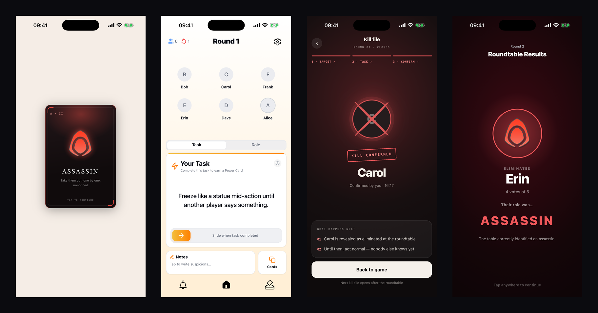

  
  
  
  
  
  

> The source code is private. This repository is a showcase: what the app looks like, how it is
> built, and the problems that made it interesting. I'm happy to walk through the code in an
> interview.

---

## What it is

Assassins is played in real life, over days, by a household — usually uni students sharing a
house. When a game starts, a few players are secretly made **assassins**; everyone else is a
**civilian**. Each round every player gets a real-world **task** (small social challenges you
complete in person), and finishing one earns a **power card**. Meanwhile the assassins pick a
target together and get a **kill task** — something they have to get that person to do without
them noticing.

When the round's timer runs out, the house gathers for a **roundtable**: the completed tasks are
revealed, the night's victim is announced, everyone argues it out, and a vote eliminates one
player. Civilians win by finding every assassin; assassins win when they match the civilians in
number.

The app deals the roles, hands out the tasks, runs the timers, drives the meeting, counts the
votes and keeps the score — so nobody has to sit out as the moderator.

---

## Feature tour

<table>
  <tr>
    <td align="center" valign="top" width="50%">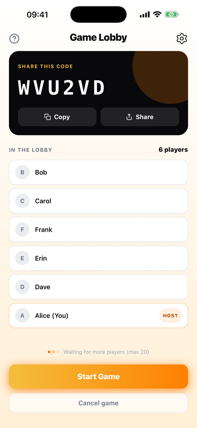 <b>Lobby</b> join with a six-character code; 4–20 players.</td>
    <td align="center" valign="top" width="50%"> <b>Secret role reveal</b> each player sees their role once, privately.</td>
  </tr>
  <tr>
    <td align="center" valign="top" width="50%">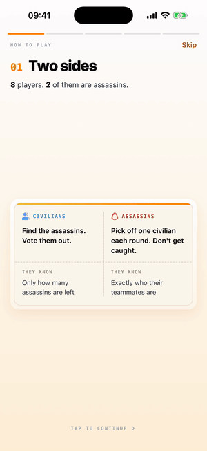 <b>Animated how-to-play</b> five screens, identical for both roles so nobody can read anything into it.</td>
    <td align="center" valign="top" width="50%">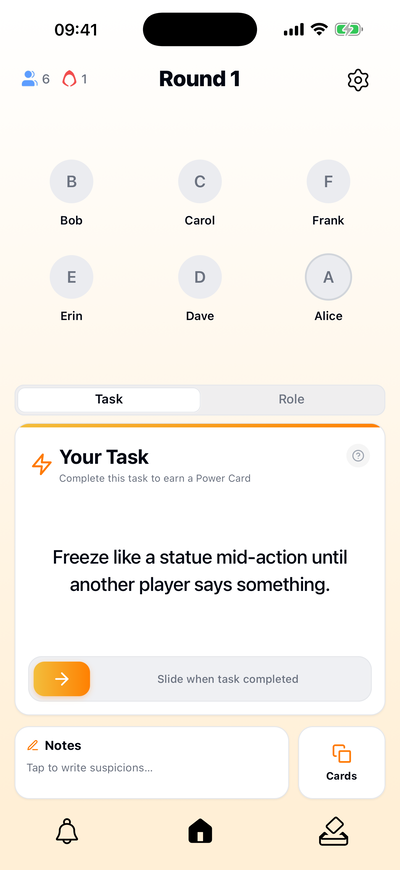 <b>Home</b> the living players, your task for the round, notes and cards.</td>
  </tr>
  <tr>
    <td align="center" valign="top" width="50%"> <b>Tasks earn power cards</b> slide when it's done and draw a card.</td>
    <td align="center" valign="top" width="50%">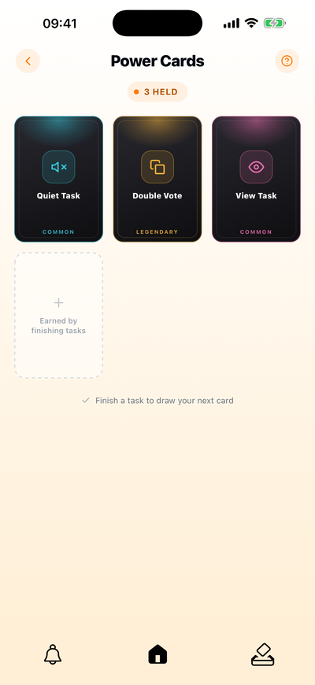 <b>Power cards</b> common, rare and legendary, played during the round or the vote.</td>
  </tr>
  <tr>
    <td align="center" valign="top" width="50%">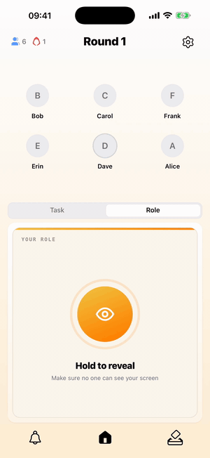 <b>Hold to reveal</b> your role stays hidden until you press and hold.</td>
    <td align="center" valign="top" width="50%">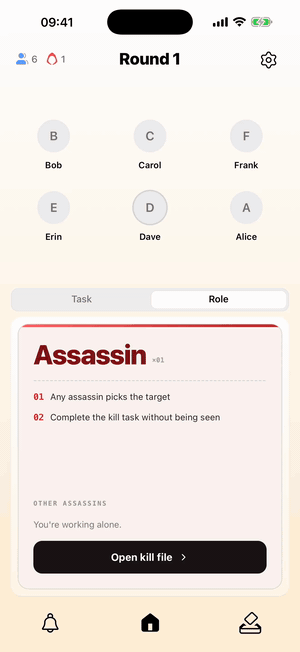 <b>The kill file</b> assassins lock a target, get a kill task and confirm the kill.</td>
  </tr>
  <tr>
    <td align="center" valign="top" width="50%">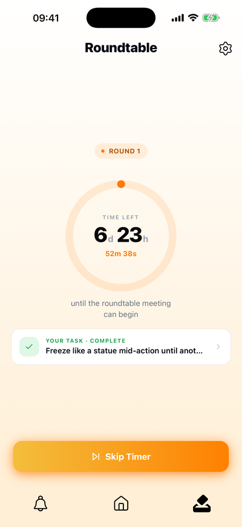 <b>The round</b> days of real-world play before the next meeting.</td>
    <td align="center" valign="top" width="50%">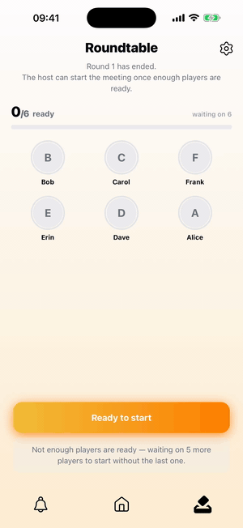 <b>Ready up</b> the meeting opens once enough of the house is in.</td>
  </tr>
  <tr>
    <td align="center" valign="top" width="50%">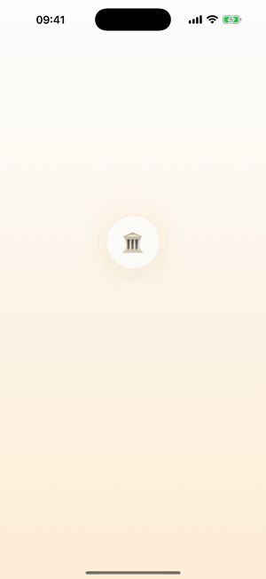 <b>Roundtable</b> the round's completed tasks are revealed one by one.</td>
    <td align="center" valign="top" width="50%">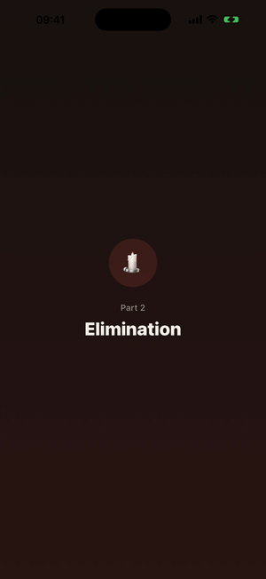 <b>The assassination</b> who didn't make it through the round, and how.</td>
  </tr>
  <tr>
    <td align="center" valign="top" width="50%">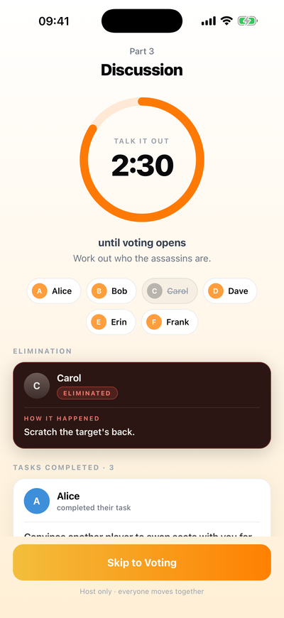 <b>Discussion</b> three minutes to argue it out, with everything that's known.</td>
    <td align="center" valign="top" width="50%">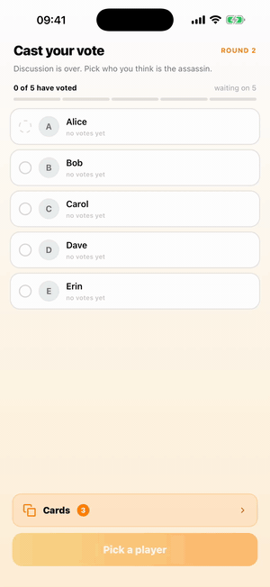 <b>The vote</b> ballots land live on every phone in the room.</td>
  </tr>
  <tr>
    <td align="center" valign="top" width="50%">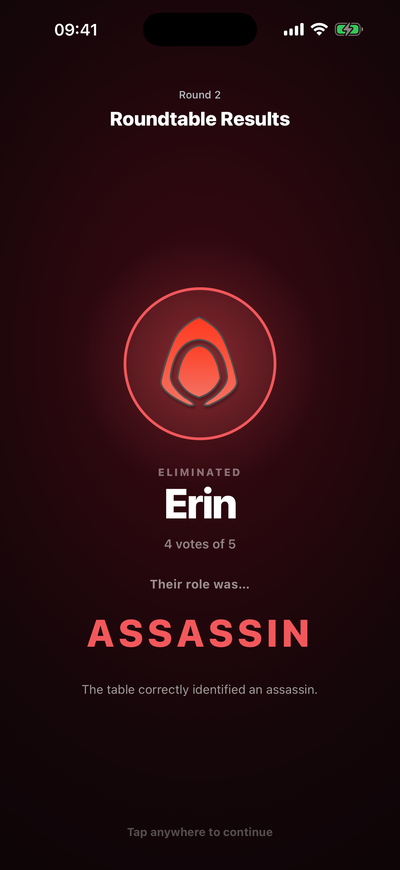 <b>Results</b> the eliminated player's role is finally shown.</td>
    <td align="center" valign="top" width="50%">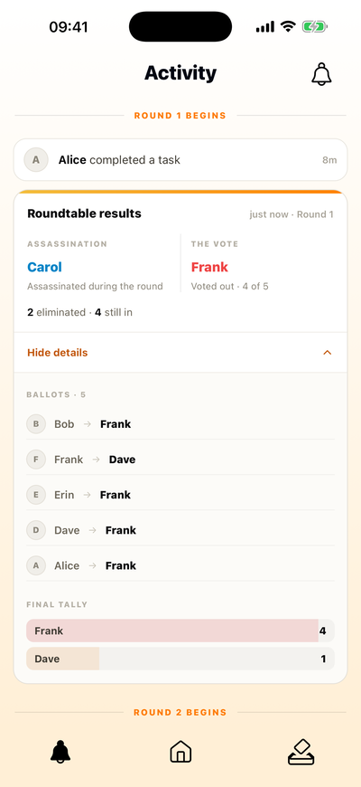 <b>Activity feed</b> the story of the game, down to who voted for whom.</td>
  </tr>
  <tr>
    <td align="center" valign="top" colspan="2">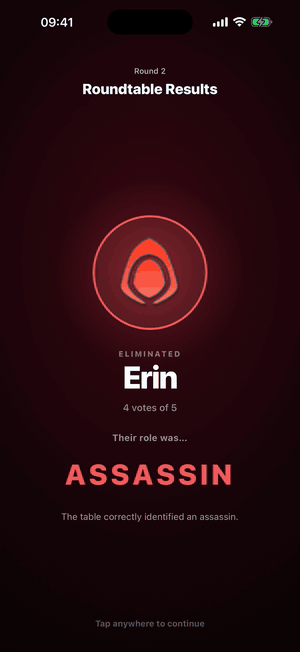 <b>Game over</b> the winning side and every role revealed.</td>
  </tr>
</table>

---

## Engineering highlights

The interesting part of this project isn't any single screen — it's that a game runs across
**4–20 phones at once**, for days, with people backgrounding the app, losing signal and closing
it mid-meeting. Some of the problems that shaped the design:

### Keeping many phones in agreement
Every change to shared game state is a transaction that checks the state it expects to be moving
*from*. If two phones try the same transition at once, one wins and the other quietly does
nothing. That made it safe to let **every** phone fire time-based transitions (the end of
discussion, the start of the vote) instead of trusting a single "host" device — an early version
did rely on the host, and a meeting froze whenever the host locked their phone.

### Secrets that the client genuinely cannot see
Roles are dealt by a server function into documents only their owner can read. No phone ever
holds the full table of roles, so anything that needs it — counting the vote, checking whether a
side has won, handling a player who leaves mid-game — runs server-side. Assassins learn who their
teammates are from their own private record, not from anyone else's.

### A game that keeps moving when nobody is looking
A scheduled backend job sweeps active games every 15 minutes: it announces rounds whose timer has
run out and nudges along meetings that no phone is currently driving. Push notifications go out
for each beat of the game, so players can leave the app closed for days.

### One rulebook, two runtimes
The pure game logic — dealing roles, drawing tasks, tallying votes, the win check, the ready-up
quorum — lives in a small shared package compiled into **both** the app and the Cloud Functions.
The client's preview of a rule and the server's enforcement of it can't drift apart.

### Testing a multiplayer game without a room full of people
The test suite runs against the local Firebase emulators and plays a **complete headless game** —
sign-ups, lobby, role deal, tasks, kills, meetings, votes, a win — through the same service layer
the app uses. A separate suite attacks the security rules directly. A manual playthrough with
friends catches the feel; the automated game catches the race conditions.

### Animation-heavy UI, built to be iterated on
The roundtable is a sequence of full-screen animated scenes (Reanimated v4). To work on them
without gathering five people, there's an in-app developer sandbox that runs the **real** meeting
screens against an in-memory backend with bot players, plus one-tap test lobbies backed by real
bot accounts.

### Architecture at a glance

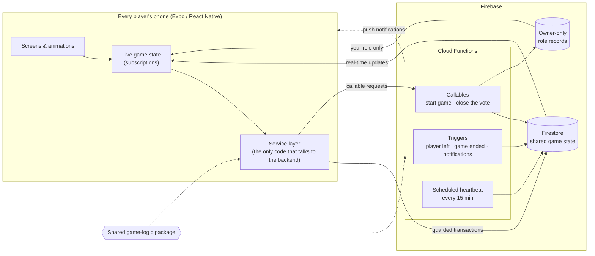

More detail — the meeting state machine and what happens when every phone closes the vote at the
same moment — is in [docs/architecture.md](docs/architecture.md).

---

## Stack

- **App:** Expo (SDK 54) with expo-router, React Native 0.81, TypeScript, NativeWind (Tailwind),
  Reanimated v4
- **Backend:** Firebase Authentication (email, Sign in with Apple, Google), Cloud Firestore,
  Cloud Storage, Cloud Functions (callables, triggers, scheduled jobs), Expo push notifications
- **Testing:** Vitest against the Firebase Emulator Suite

## Status

In active development and closed testing with real households. The source is private.

Built by [Joseph Meadowcroft](https://github.com/josephmeadowcroft).

© Joseph Meadowcroft. All rights reserved — see [LICENSE](LICENSE).
