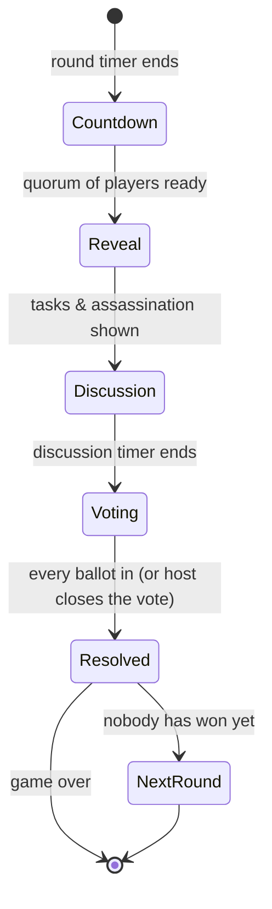
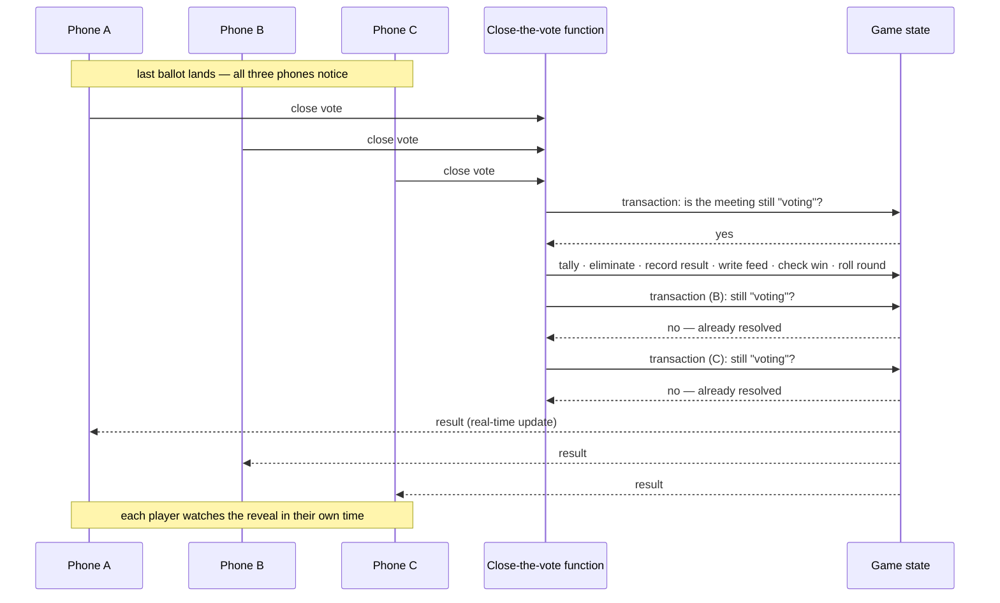

# Architecture notes

A closer look at the parts of Assassins that were hardest to get right. The source is private, so
this is a description of the approach rather than the code.

## The constraint

A game of Assassins is one shared state machine with up to 20 independent clients. Any of them
can be backgrounded, offline, or closed at any moment, and the game lasts days. Two rules followed
from that early on:

1. **No single device is in charge.** Anything that has to happen when a timer runs out must
   happen even if one particular phone is asleep.
2. **No client is trusted with secrets.** A player who inspects their own app's network traffic
   must learn nothing about anyone else's role.

## The roundtable state machine

The meeting at the end of each round is the most contested part of the game: every phone in the
room is watching the same screens, at the same time, and several of them may try to move it on at
once.

Every arrow is a transaction that first reads the current phase and only writes if it matches
the phase the caller expected to leave. That one check is what makes transitions **idempotent**:

- Time-based transitions (end of discussion, end of reveal) are fired by **every** phone that
  notices the deadline. The first one moves the game; the rest find the phase has already changed
  and do nothing.
- Manual controls (skip the timer, end discussion early, close the vote on a holdout) are
  host-only, and keep working even after the host has been voted out.
- If **no** phone is watching, a scheduled backend job moves stalled meetings along — but never
  closes a vote on partial ballots, because that would decide the game for people who didn't vote.

### The ready-up quorum

A meeting can't wait forever for the one housemate who's out. Players ready up, and the meeting
opens once enough of them have: everyone, everyone but one, or a simple majority once an hour has
passed since the round ended. The same pure function decides this on the phone (to show the
progress bar) and on the server (to enforce it).

## Closing the vote

Closing the vote is the single most important write in the game: it decides who is eliminated,
whether the game is over, and starts the next round. It runs as one server-side transaction.

Because the win check needs the whole table's roles, this can't run on a phone. The results
reveal afterwards is just each phone reading the recorded result, so a player who closes the app mid-reveal loses nothing.

## Secrets

- Roles are dealt by a server function into per-player records readable only by their owner.
- A player's role becomes public only when they are eliminated.
- Assassins learn their teammates from their own private record.
- The "assassins remaining" counter everyone sees is maintained server-side, so it can be shown
  without revealing who they are.
- When a living player leaves mid-game, a backend trigger re-checks the win condition — the
  client that left can't, because it doesn't know the other roles.

## Shared logic

A small, dependency-free package holds the deterministic game rules: the role deal (and how many
assassins for a given table size), task and kill-task draws, the tally and win check, the
ready-up quorum, and stable ids for feed events. It's compiled into both the React Native app and
the Cloud Functions project, so the phone's preview of a rule and the server's enforcement of it
are the same code.

## Testing

- **Full headless game.** A Vitest suite signs up a table of fake players against the Firebase
  emulators and plays a game end to end through the app's real service layer — including the
  races, like several phones closing the same vote.
- **Security rules.** A separate suite tries the writes a modified client might attempt and
  asserts they're refused.
- **Sign-in providers.** Apple and Google sign-in are exercised with fake identity tokens against
  the auth emulator.
- **On device.** Animation and feel are checked by hand; a developer sandbox replays the real
  meeting screens with bots so that doesn't need five people in a room.

## What I'd do next

- Finish moving the remaining game logic behind Cloud Functions, so the server is the only
  authority on every random draw.
- Restructure ballots so a vote can be genuinely anonymous until the reveal.
- CI running the emulator suites on every push.
